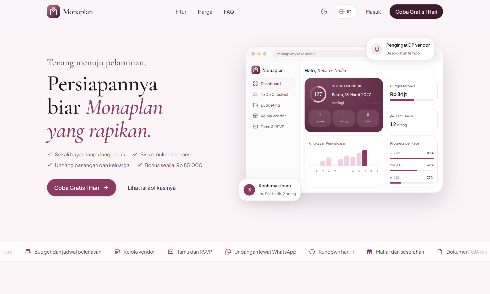
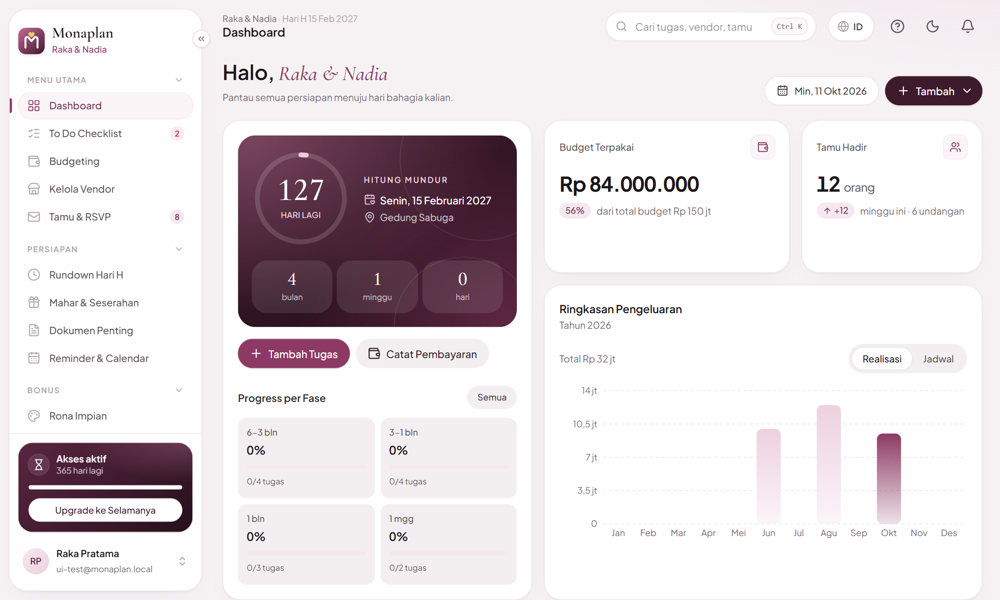
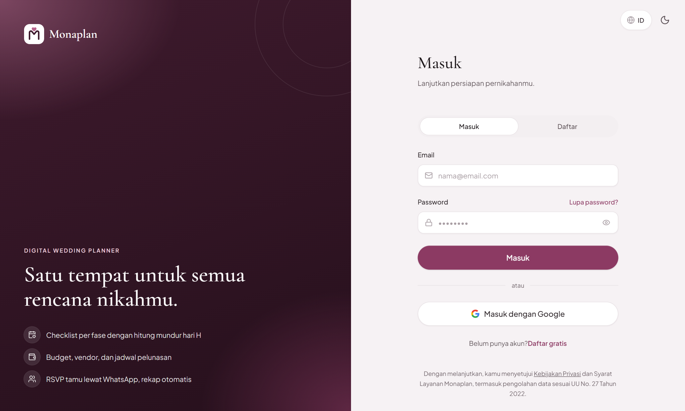
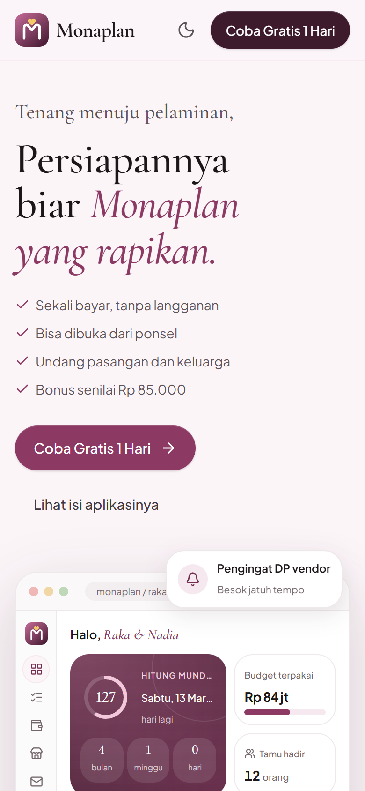

<div align="center">


### Satu tempat untuk semua rencana nikahmu

Aplikasi web wedding planner all-in-one: checklist, budget, vendor, tamu dan RSVP, rundown hari H, sampai dokumen pernikahan.

[](https://monaplan.vercel.app)


</div>

---

## Tampilan

<div align="center">

</div>

<br />

<table>
  <tr>
    <td width="62%"></td>
    <td width="38%"></td>
  </tr>
  <tr>
    <td align="center"><sub>Dashboard: hitung mundur, budget, tamu, dan progres persiapan</sub></td>
    <td align="center"><sub>Undangan digital dengan lima tema</sub></td>
  </tr>
  <tr>
    <td></td>
    <td></td>
  </tr>
  <tr>
    <td align="center"><sub>Checklist berfase dengan tenggat otomatis</sub></td>
    <td align="center"><sub>Responsif di ponsel</sub></td>
  </tr>
</table>

## Fitur

**Untuk pengantin**

| | |
|---|---|
| ✅ **Checklist** | Tugas persiapan berfase, tenggatnya dihitung dari tanggal pernikahan. Template Umum dan adat Jawa, Sunda, Bali, Minang, Batak. Bagi tugas berdua dengan progres per orang. |
| 💰 **Budgeting** | Anggaran per kategori, jadwal pembayaran, pembagian biaya pihak pria dan wanita, dan target tabungan per bulan. |
| 🏪 **Vendor** | Pantau status negosiasi, DP, dan pelunasan. |
| 💌 **Tamu & RSVP** | Daftar tamu, undangan lewat WhatsApp, konfirmasi kehadiran, dan QR masuk untuk tamu yang hadir. |
| 🎴 **Undangan digital** | Tautan sendiri per pasangan dan per nama tamu, dengan lima tema. |
| 🕒 **Rundown & Kalender** | Rundown hari H dan sinkronisasi Google Calendar. |
| 🎉 **Mode Hari H** | Rundown yang berjalan sesuai jam, kontak vendor, check-in tamu dengan QR, dan tautan panitia tanpa akun. |
| 🧧 **Amplop & Kado** | Catatan amplop, transfer, dan kado, plus ucapan terima kasih lewat WhatsApp. |
| 📄 **Dokumen** | Berkas penting dan persyaratan KUA. |
| 🎁 **Mahar & Seserahan** | Rencana, harga, dan status pembelian. |
| 🎨 **Rona Impian & Honeymoon** | Papan inspirasi dan perencana bulan madu. |
| 🤝 **Kolaborasi** | Ajak pasangan atau keluarga dengan peran pemilik, editor, atau pembaca. |

**Untuk pengelola**

- Panel admin: pengguna, order dan lisensi, paket, promo, kode akses, trial, audit, dan ringkasan kondisi sistem.
- Pembayaran online, kode promo, dan kode akses dari reseller.

Tersedia dalam **bahasa Indonesia dan Inggris**, dengan **mode terang dan gelap**. Bisa dipasang di HP sebagai aplikasi (PWA) dengan notifikasi push.

## Tech stack

| Bagian | Teknologi |
|---|---|
| Framework | Next.js 16 (App Router, Server Actions), React 19, TypeScript |
| Tampilan | Tailwind CSS v4, Lucide, Recharts |
| Database dan autentikasi | Supabase: PostgreSQL dengan Row Level Security, Auth, Realtime |
| Penyimpanan berkas | Cloudflare R2 |
| Pembayaran | Midtrans Snap |
| Email | Resend |
| Keamanan | Cloudflare Turnstile, Content Security Policy, validasi dengan Zod |
| Integrasi | Google OAuth dan Google Calendar, Web Push (VAPID), pemindai dan pembuat QR (qr-scanner, uqr) |
| Hosting dan pemantauan | Vercel (Analytics dan Speed Insights) |
| Pengujian | Uji database dengan PGlite, uji pustaka dan terjemahan dengan skrip Node |

## Struktur singkat

```
src/app          Halaman dan rute (aplikasi, admin, undangan publik, API)
src/components   Komponen UI, landing, dan undangan
src/features     Server Actions per modul
src/lib          Akses data, helper, dan integrasi
src/content      Konten statis: tema undangan, tur, bantuan, pilihan adat
src/i18n         Kamus terjemahan
supabase         Migrasi SQL dan uji database
```

## Skrip

```bash
npm run dev         # server pengembangan
npm run build       # build produksi
npm run typecheck   # pemeriksaan tipe
npm run test:db     # uji skema dan aturan akses database
npm run test:lib    # uji fungsi pustaka
npm run test:i18n   # uji kelengkapan terjemahan
```

## Notifikasi HP (opsional)

Buat kunci sekali dengan `npx web-push generate-vapid-keys`, lalu isi di `.env` dan di Vercel:

```bash
NEXT_PUBLIC_VAPID_PUBLIC_KEY=...
VAPID_PRIVATE_KEY=...
VAPID_SUBJECT=mailto:admin@domainkamu.id
```

Bila kosong, fitur notifikasi HP otomatis disembunyikan. Push dikirim oleh `/api/cron/reminders` dan saat tamu mengirim RSVP.
